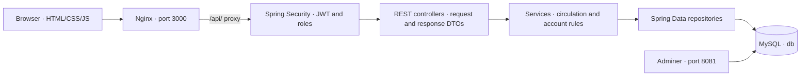
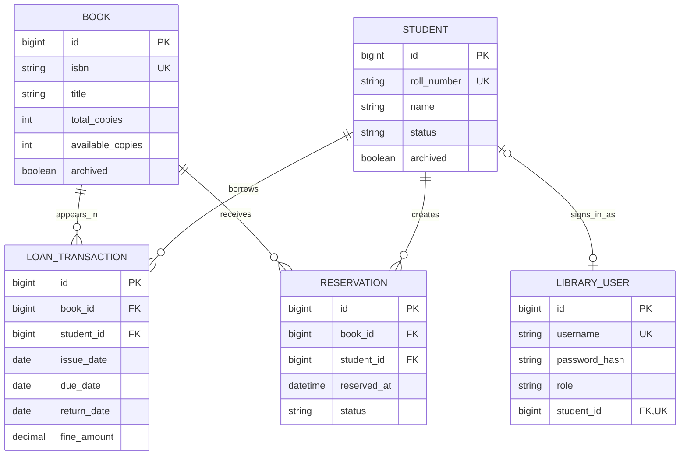
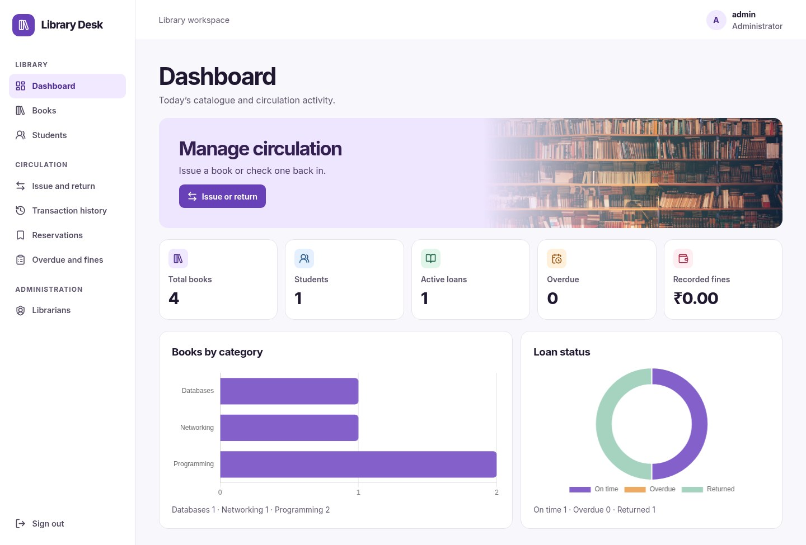
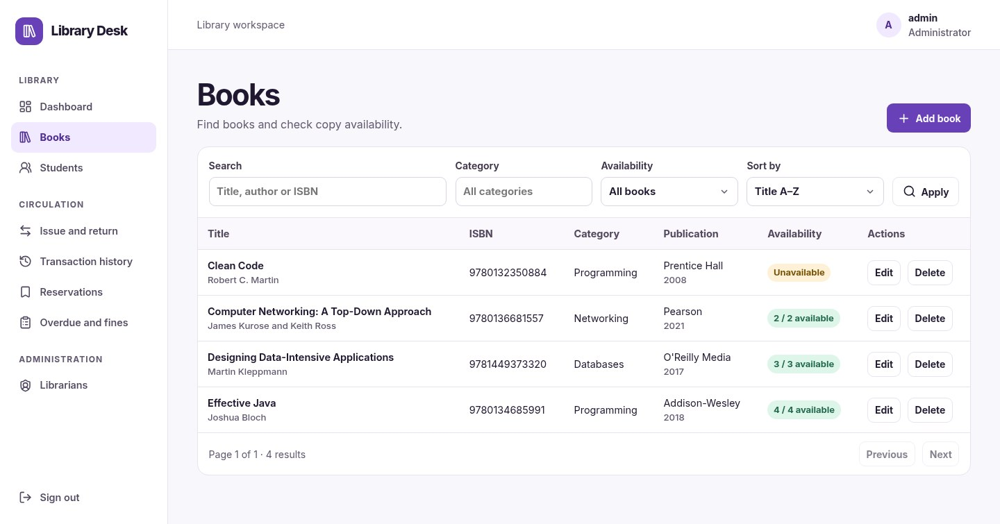

# Library Management System

Library Desk gives a college library one place to manage its catalogue, student records, and circulation. Staff can see which copies are available, issue and return books, and review overdue loans and fines. Students can search the catalogue, reserve unavailable books, and view their own loans.

| Role | Access |
| --- | --- |
| Administrator | All librarian actions, plus creating, resetting, and removing librarian accounts |
| Librarian | Book and student management, student login creation, issue and return, reservations, reports, and dashboard |
| Student | Catalogue search, own reservations, own loans, history, and fines |

Books support server-side search, category and availability filters, sorting, and pagination. An active student can borrow up to three different books at once. The loan period is 14 days, and a late return costs ₹5 per day after the due date. Staff can archive books and students after their active loans are resolved. Completed transaction history stays available.

## Tech stack

| Layer | Tools |
| --- | --- |
| Frontend | HTML, CSS, vanilla JavaScript, Chart.js, Lucide, Nginx |
| Backend | Java 17, Maven, Spring Boot 3, Spring MVC, Spring Security, JWT, BCrypt, Jakarta Bean Validation, Actuator, springdoc-openapi |
| Database | MySQL 8, Spring Data JPA and Hibernate. H2 is used by the test profile. |
| Verification | JUnit 5, Mockito, MockMvc, GitHub Actions, Docker Compose |

## Architecture





Each loan and reservation references a book and a student. A student may have one account, and staff accounts have no student link. MySQL schema creation and demo seeding run automatically. The [reference schema](backend/src/main/resources/schema.sql) documents the tables.

## Run with Docker

The only prerequisite is Docker Desktop with Compose. Open a terminal in the repository root and run:

```bash
docker compose up --build
```

The first run downloads base images and Maven dependencies. The checked-in `.env` provides local demo settings. MySQL initializes its volume, then the backend creates its tables and seeds three books and the accounts below. Nginx starts after the backend health check passes.

| Service | URL |
| --- | --- |
| Library Desk | http://localhost:3000 |
| API and Swagger UI | http://localhost:8080/swagger-ui.html |
| Backend health | http://localhost:8080/actuator/health |
| Adminer | http://localhost:8081 |

| Role | Username | Demo password |
| --- | --- | --- |
| Administrator | `admin` | `DemoAdmin123!` |
| Librarian | `librarian` | `DemoLibrarian123!` |
| Student | `student` | `DemoStudent123!` |

In Adminer choose **MySQL**, use server `db`, and enter the `MYSQL_USER`, `MYSQL_PASSWORD`, and `MYSQL_DATABASE` values from `.env`.

Stop the stack and retain the database:

```bash
docker compose down
```

Reset the demo database. This deletes the Compose volume and all library records stored in it:

```bash
docker compose down -v
docker compose up --build
```

### Troubleshooting

| Symptom | Check |
| --- | --- |
| Docker cannot connect | Start Docker Desktop and run `docker compose version`. |
| Port 3000, 8080, or 8081 is busy | Free the port or change the host-side port mapping in `docker-compose.yml`. |
| MySQL or the backend is unhealthy | Run `docker compose ps` and `docker compose logs db backend`. An existing MySQL volume keeps its original credentials even when `.env` changes. Restore the previous credentials or reset the demo volume if its data can be discarded. |
| Build runs out of disk space | Free space in Docker Desktop and rerun the build. The first build downloads the Maven, Java, Nginx, MySQL, and Adminer images. |
| Login stops working after a backend restart | Sign in again. By default each backend startup creates a fresh JWT signing key. To keep sessions valid across restarts, supply a stable Base64-encoded secret of at least 32 bytes in `LIBRARY_JWT_SECRET`. See [environment examples](.env.example). |

For a local build I/O error or to run published images, see the [container release guide](deploy/README.md).

## API

Log in through `POST /api/auth/login` and send the returned token as `Authorization: Bearer <token>` on protected requests. Swagger UI accepts the token through **Authorize**. List endpoints with pagination accept zero-based `page`, `size` (up to 100), and `sort=field,direction`.

| Method and endpoint | Who can use it | Purpose |
| --- | --- | --- |
| `POST /api/auth/login` | Public | Exchange username and password for a JWT and role |
| `GET /api/books` | All roles | Catalogue search with `q`, `category`, and `available` filters |
| `GET /api/books/{id}` | All roles | Read an active book |
| `POST /api/books`, `PUT /api/books/{id}`, `DELETE /api/books/{id}` | Staff | Create, update, and archive books |
| `GET /api/students`, `GET /api/students/{id}` | Staff | Read student records |
| `POST /api/students`, `PUT /api/students/{id}`, `DELETE /api/students/{id}` | Staff | Create, update, and archive students |
| `POST /api/students/{id}/account` | Staff | Create a student login |
| `GET /api/librarians`, `POST /api/librarians` | Administrator | List or create librarian accounts |
| `PUT /api/librarians/{id}/password`, `DELETE /api/librarians/{id}` | Administrator | Reset a password or remove access |
| `POST /api/transactions/issue`, `POST /api/transactions/{id}/return` | Staff | Issue a book or record its return |
| `GET /api/transactions` | Staff | History with optional `studentId`, `bookId`, and `activeOnly` |
| `GET /api/transactions/overdue`, `GET /api/transactions/fines` | Staff | Overdue loans and fines report |
| `GET /api/transactions/me`, `GET /api/transactions/me/fines` | Student | Own loans, history, and fines |
| `GET /api/reservations`, `DELETE /api/reservations/{id}` | All roles | List or cancel reservations, scoped to the student when applicable |
| `POST /api/reservations` | Student | Reserve an unavailable book |
| `GET /api/dashboard` | Staff | Catalogue, student, loan, overdue, and recorded fine totals |

The API uses JSON validation errors with `status`, `message`, `path`, and an `errors` map for field validation. A conflict such as an unavailable book returns HTTP 409.

## Tests and demonstration

Run the backend tests without Docker or MySQL:

```bash
cd backend
mvn test
```

GitHub Actions runs the Maven tests, builds both images, and checks the Compose stack through its published ports. See the [test plan](TEST_PLAN.md) for scenarios and [viva notes](VIVA_NOTES.md) for a demonstration sequence and 25 review questions.

## Screenshots

| Staff dashboard | Book catalogue |
| --- | --- |
|  |  |
